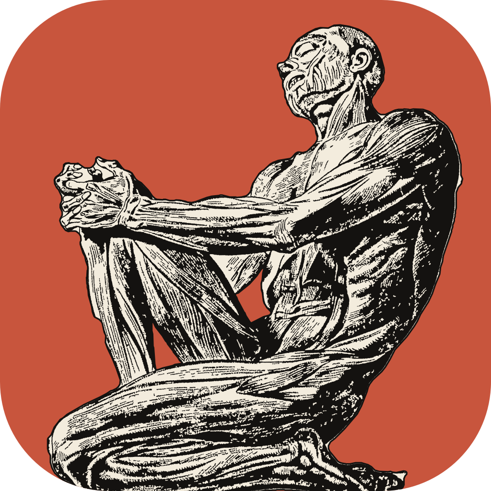

<h1 align="center">HoudonRef</h1>

Open-source tool for artists: an anatomy atlas, a 3D reference studio and a timed drawing atelier.

> Status: early planning. Nothing to run yet.

Code licence: [GPL-3.0](LICENSE). Logo and third-party content keep their own licences (see Credits).

## What it is

HoudonRef helps artists learn form, light and anatomy by drawing from 3D models. It has three sections:

| Section | What it is for |
| --- | --- |
| **Atlas** | Interactive écorché by layers (skin → superficial muscles → deep muscles → skeleton), names in English, Russian and Latin, later animals |
| **Studio** | View and pose your own models (glTF, OBJ, FBX, .blend via Blender), full lighting setup with presets and rooms, still-life generator, reference-search plugins |
| **Atelier** | Timed drawing sessions: complexity progression (Loomis ball → planes → detailed head with the same light), rotating camera angles, pose changes, light changes, focal length and focus |

## Principles

- Runs on weak hardware: rendering targets the OpenGL ES 3.0 / WebGL2 feature level.
- One codebase for desktop (Windows, Linux, macOS), web and Android.
- Rust + `wgpu` + `egui`.
- Open data: series, light presets and rooms are plain files (glTF + RON).

## Credits

- Name after Jean-Antoine Houdon, sculptor of the *Écorché* (1767).
- Logo after *A kneeling écorché figure* by J. Gamelin (1778/79). Source image: [Wellcome Collection](https://wellcomecollection.org/works/gv249kuf), CC BY 4.0.
- Planned anatomy data: [Écorché](https://github.com/Charleeh/ecorche) and [Z-Anatomy](https://www.z-anatomy.com/), both CC BY-SA 4.0. Anatomy content will ship as separate content packs under its own licence.
